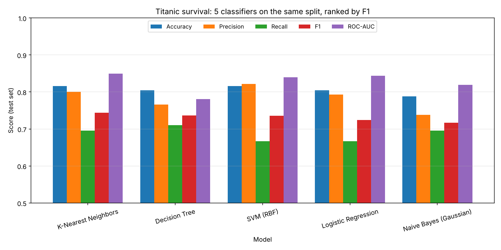

# Comparing 5 Supervised Learning Algorithms on Titanic Survival

A fair, side-by-side comparison of five classifiers trained on the **same dataset, same train/test split and same preprocessing**.



## Dataset

[Titanic passenger data](https://github.com/datasciencedojo/datasets) (891 passengers, 38.4% survived). Task: predict `Survived` (binary classification).

It is a good test bed because it isn't trivially separable (unlike Iris) and it has the messy features the task asks us to handle:

| Feature | Type | Issue handled |
|---|---|---|
| `Age` | numeric | 177 missing values → median imputation |
| `Embarked` | categorical | 2 missing values → most-frequent imputation, one-hot encoded |
| `Sex` | categorical | one-hot encoded |
| `Pclass`, `SibSp`, `Parch`, `Fare` | numeric | standardized |

Dropped: `PassengerId`, `Name`, `Ticket` (identifiers) and `Cabin` (77% missing).

## Method

- **Split:** 80/20 stratified (`random_state=42`) → 712 train / 179 test. All five models use this exact split.
- **Preprocessing** (one `ColumnTransformer` inside a `Pipeline`, fit on the training set only, so there is no test leakage): median impute + `StandardScaler` for numerics, most-frequent impute + `OneHotEncoder` for categoricals.
- **Scaling for every model:** KNN, SVM and logistic regression need it; the tree and Naive Bayes don't, but applying identical preprocessing to all five keeps the comparison fair (it doesn't hurt them).
- **Models:** scikit-learn defaults, no hyperparameter tuning (`LogisticRegression`, unpruned `DecisionTreeClassifier`, `KNeighborsClassifier(k=5)`, `SVC(kernel="rbf")`, `GaussianNB`).
- **Metrics:** accuracy, precision, recall, F1 and ROC-AUC on the test set. Models are ranked by **test F1** (the positive class, survived, is the minority, so F1 is more informative than accuracy alone). As a robustness check I also report 5-fold cross-validated accuracy on the training set and training accuracy (to expose overfitting).

## Results

| Rank | Model | Accuracy | Precision | Recall | F1 | ROC-AUC | Train Acc | CV Acc (5-fold) |
|---:|---|---:|---:|---:|---:|---:|---:|---:|
| 1 | K-Nearest Neighbors | 0.8156 | 0.8000 | 0.6957 | **0.7442** | 0.8495 | 0.8511 | 0.7977 ± 0.0164 |
| 2 | Decision Tree | 0.8045 | 0.7656 | 0.7101 | 0.7368 | 0.7808 | 0.9831 | 0.7655 ± 0.0163 |
| 3 | SVM (RBF) | 0.8156 | 0.8214 | 0.6667 | 0.7360 | 0.8401 | 0.8427 | 0.8216 ± 0.0247 |
| 4 | Logistic Regression | 0.8045 | 0.7931 | 0.6667 | 0.7244 | 0.8437 | 0.8076 | 0.7963 ± 0.0278 |
| 5 | Naive Bayes (Gaussian) | 0.7877 | 0.7385 | 0.6957 | 0.7164 | 0.8191 | 0.7907 | 0.7936 ± 0.0301 |

Confusion matrices on the test set, as `[[TN, FP], [FN, TP]]`:
Logistic Regression `[[98, 12], [23, 46]]` · Decision Tree `[[95, 15], [20, 49]]` · KNN `[[98, 12], [21, 48]]` · SVM `[[100, 10], [23, 46]]` · Naive Bayes `[[93, 17], [21, 48]]`.

Raw numbers: `results.csv`, `confusion_matrices.json`, `run_output.txt`.

### An honest caveat first

The five models are **close**. With only 179 test passengers, the standard error on an accuracy of ~0.80 is about ±3 percentage points, and the gap between best and worst accuracy is 2.8 points (5 passengers). So the ranking above shows tendencies, not a statistically solid ordering, and a different random split could reshuffle the middle of the table. The cross-validation column is a useful second opinion, and it doesn't fully agree with the test ranking (SVM is best on CV, the decision tree worst). The explanations below are hypotheses that fit the data, not results I proved with ablations.
## Analysis

**Best model: K-Nearest Neighbors (F1 0.744, ROC-AUC 0.850), with SVM close behind.**
Survival on the Titanic depends on combinations of features, not on each one separately. For example, women in 1st and 2nd class mostly survived, men in 3rd class mostly didn't, and age mattered differently for each sex. KNN and the RBF SVM are non-linear and local, so they can pick up these combinations by looking at "passengers similar to this one" without being told about them. The data also has only about 9 features after encoding, so distances stay meaningful, and scaling stops `Fare` from dominating the distance. SVM had the best cross-validated accuracy (0.822) and the best precision.

**Worst model on the test set: Naive Bayes (accuracy 0.788, F1 0.716).**
Naive Bayes assumes features are independent once the class is known, and that isn't true here. `Fare`, `Pclass` and `Embarked` are related, so the same information gets counted more than once. The one-hot columns of one variable are also completely dependent on each other, and `Fare` is skewed rather than Gaussian. It also can't model combinations like sex × class. This shows up as more false positives (17, against 10 to 15 for the other models).

**Decision Tree overfit.**
It scored 98.3% on the training data but only 80.5% on the test set and 76.6% in cross-validation. Without a depth limit it memorizes individual passengers. It also had the lowest ROC-AUC (0.781).

**Logistic Regression** was competitive (accuracy 0.8045, AUC 0.844) because sex alone explains most of survival, even though it can't capture interactions without extra features.

**Caveat:** the test set has only 179 passengers, so the margin of error is about ±3 points, which is as big as the gap between the models. The ranking is a tendency, not a proven order, and I did not tune any hyperparameters.t and most interpretable model, with a small train/test gap, so it is the safest choice if explainability matters.

## Takeaways

1. On low-dimensional tabular data with strong interactions, local and kernel methods (KNN, RBF-SVM) have an edge over linear or independence-assuming models, but the margin here is small.
2. Training accuracy is a poor guide: the tree "won" on the training set (98%) and lost in cross-validation.
3. Always check variance. On 179 test samples, ±3 points of noise is as large as the whole spread between the five models.

## Run it

```bash
pip install -r requirements.txt
python compare_models.py
```

This regenerates `model_comparison.png`, `results.csv` and `confusion_matrices.json`. Results are reproducible (`random_state=42` everywhere).

## Project layout

| File | Purpose |
|---|---|
| `compare_models.py` | Preprocessing pipeline, trains and evaluates all 5 models, builds the chart |
| `data/titanic.csv` | Dataset |
| `results.csv`, `confusion_matrices.json`, `run_output.txt` | Output of the run reported above |
| `model_comparison.png` | Comparison chart |
